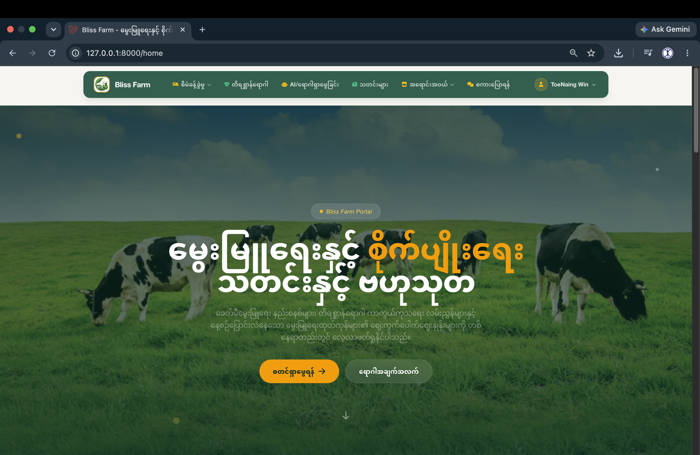

# 🌱 Bliss Farm

**AI-Powered Livestock Management Platform for Myanmar Farmers**

Bliss Farm is a web-based platform designed to help farmers manage livestock, identify potential animal diseases, access livestock-related information, and connect with buyers and sellers. The project combines modern web technologies with AI-assisted features to support smarter livestock farming in Myanmar.


## 📌 Table of Contents

- [About the Project](#-about-the-project)
- [Key Features](#-key-features)
- [Technology Stack](#-technology-stack)
- [Project Structure](#-project-structure)
- [Getting Started](#-getting-started)
- [Environment Configuration](#-environment-configuration)
- [Database Setup](#-database-setup)
- [Running the Application](#-running-the-application)
- [Team](#-team)
- [Future Improvements](#-future-improvements)
- [Contributing](#-contributing)
- [License](#-license)

## 🌾 About the Project

Livestock farming plays an important role in Myanmar's agricultural economy. However, farmers may face challenges in managing animals, identifying diseases, accessing reliable information, and finding suitable markets.

Bliss Farm aims to address these challenges through an integrated digital platform that provides livestock management tools, AI-assisted disease detection, and online marketplace functionality.

**Our mission:** To make livestock farming smarter, more accessible, and more efficient through technology.

## ✨ Key Features

### 🐄 1. Livestock Management
- Register and manage livestock records.
- Automatically generate animal identification numbers.
- Support multiple animal types, including pigs, cows, goats, chickens, ducks, fish, buffaloes, sheep, and others.
- Track animal age, weight, purpose, and other relevant information.
- View livestock statistics and dashboard charts.

### 🩺 2. AI-Assisted Animal Disease Detection
- Support disease-related analysis for selected livestock types.
- Help users identify potential diseases using AI-powered features.
- Provide relevant disease information and guidance.
- Support image-based analysis where configured.

*AI-generated results are informational and should not replace professional veterinary diagnosis.*

### 🛒 3. Livestock Marketplace
- Browse livestock-related products and listings.
- Connect buyers and sellers.
- Support livestock trading and marketplace interactions.

### 📰 4. Livestock News and Information
- Access livestock-related news and educational information.
- Help farmers learn about animal care, farming practices, and disease prevention.

### 💬 5. Community and Conversations
- Enable communication between users.
- Support community interaction and information sharing.

### 🔐 6. User Authentication
- Support user authentication and account management.
- Provide Google sign-in where configured.
- Protect user-specific features and data through appropriate authorization.

### 🤖 7. AI and Workflow Integration
- Integrate AI services for selected application features.
- Support configurable AI model providers.
- Allow workflow automation through n8n where configured.

## 🧰 Technology Stack

| Technology | Purpose |
|---|---|
| PHP | Backend programming |
| Laravel | Web application framework |
| MySQL | Relational database |
| HTML5 | Web page structure |
| CSS3 | Styling and responsive layouts |
| JavaScript | Interactive functionality |
| Vite | Frontend asset development |
| Chart.js | Dashboard data visualization |
| Laravel Socialite | Social authentication |
| AI APIs | AI-assisted functionality |
| n8n | Workflow automation, where configured |

## 📂 Project Structure

The project follows Laravel's standard application structure.

```text
Bliss_Farm/
├── app/
│   ├── Http/
│   │   ├── Controllers/
│   │   └── Middleware/
│   ├── Models/
│   └── Providers/
├── bootstrap/
├── config/
├── database/
│   ├── factories/
│   ├── migrations/
│   └── seeders/
├── public/
├── resources/
│   ├── css/
│   ├── js/
│   └── views/
├── routes/
│   ├── web.php
│   └── console.php
├── storage/
├── tests/
├── .env.example
├── artisan
├── composer.json
├── package.json
└── README.md
```

*Additional folders and files may exist depending on the modules and integrations implemented in your current branch.*

## 🚀 Getting Started

Follow these instructions to run Bliss Farm locally.

### Prerequisites

Install the following software before starting:

- PHP 8.2 or a compatible version required by `composer.json`
- Composer
- Node.js and npm
- MySQL
- Git

### 1. Clone the Repository

```bash
git clone https://github.com/MgToeNaingWin/Bliss_Farm.git
cd Bliss_Farm
```

### 2. Install PHP Dependencies

```bash
composer install
```

### 3. Install Frontend Dependencies

```bash
npm install
```

### 4. Configure the Environment

Create a local environment file:

```bash
cp .env.example .env
```

Generate the Laravel application key:

```bash
php artisan key:generate
```

### 5. Create the Database

Create a MySQL database named `bliss_farm`, or choose another name and update your environment configuration accordingly.

### 6. Configure Database Credentials

Update the database settings in your `.env` file.

```dotenv
DB_CONNECTION=mysql
DB_HOST=127.0.0.1
DB_PORT=3306
DB_DATABASE=bliss_farm
DB_USERNAME=root
DB_PASSWORD=
```

Replace the username and password with your local MySQL credentials.

### 7. Run Database Migrations

```bash
php artisan migrate
```

If the project provides seeders and you want to populate the database with sample data, you may also run:

```bash
php artisan db:seed
```

Only run database reset commands on a development database when you are comfortable losing its existing data.

### 8. Build Frontend Assets

For development:

```bash
npm run dev
```

Alternatively, build production assets:

```bash
npm run build
```

### 9. Start the Laravel Server

Open another terminal in the project directory and run:

```bash
php artisan serve
```

Open the local URL displayed in your terminal, usually:

http://127.0.0.1:8000

## ⚙️ Environment Configuration

Some features require additional configuration depending on the integrations enabled in your project.

Examples include:

- Google OAuth credentials for Google sign-in.
- AI provider API keys for AI-assisted features.
- Mail service credentials for email functionality.
- n8n webhook URLs for configured automation workflows.

Keep these values in your local `.env` file or an appropriate secret-management system.

**Security note:** Never commit your `.env` file, passwords, API keys, OAuth secrets, or other sensitive credentials to GitHub. Use `.env.example` to document the required variable names without including real secret values.

## 👥 Team

**Team Name: CollabX**

Bliss Farm is developed collaboratively by the following team members:

- **Mg Toe Naing Win** — Team Leader
- Mg Aung Aung Oo
- Mg Aung Phyo Naing
- Mg Wai Phyo Thar
- Mg Min Htet Naing

## 🔮 Future Improvements

Potential areas for future development include:

- Improved AI-assisted disease detection and validation.
- More detailed livestock health and growth analytics.
- Enhanced livestock price prediction and market insights.
- Mobile-friendly interfaces and mobile application support.
- Multilingual support for Myanmar farmers.
- Notifications and reminders for livestock care.
- Additional marketplace and communication features.
- Improved security, testing, and deployment automation.

## 🤝 Contributing

Contributions, suggestions, and bug reports are welcome.

1. Fork the repository.
2. Create a feature branch.
3. Make your changes.
4. Test your changes locally.
5. Commit your work with a clear commit message.
6. Open a pull request for review.

Example:

```bash
git checkout -b feature/your-feature
git add .
git commit -m "Add your feature"
git push origin feature/your-feature
```

## 📄 License

This project is developed as a collaborative software project. A specific open-source license has not been declared in this README.

If you intend to distribute the project publicly, consider adding an appropriate `LICENSE` file.

---

**Bliss Farm — Empowering Myanmar Farmers Through Technology 🌱**

GitHub Repository: https://github.com/MgToeNaingWin/Bliss_Farm
